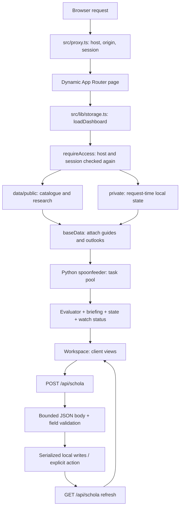
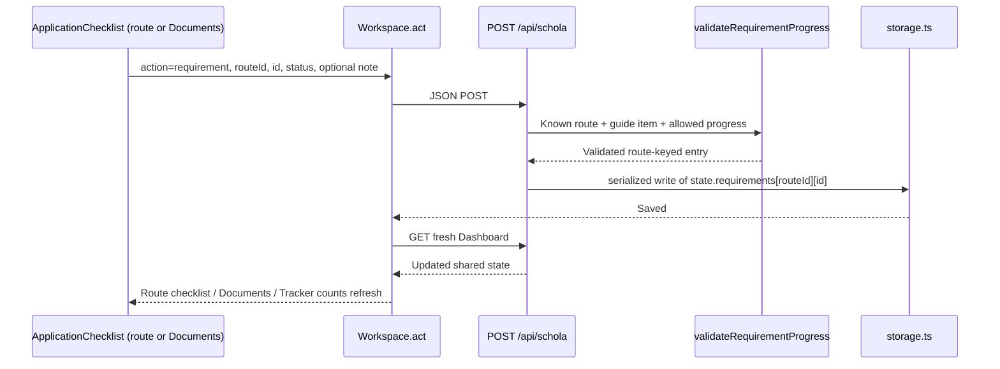

# Repository map

This is a source map for a fresh clone, not an inventory of a running installation.
Start with [AGENTS.md](../AGENTS.md), [PRODUCT.md](../PRODUCT.md), and [README.md](../README.md).
The application is Next.js App Router + TypeScript + Tailwind, with Python standard-library modules for planning and monitoring, plus an optional pinned LangGraph research runtime.
Dependency versions and commands live in [package.json](../package.json); the installed Next.js guides under `node_modules/next/dist/docs/` take precedence over remembered framework conventions.

## Request and data flow

[storage.ts](../src/lib/storage.ts) is `server-only`. It reads JSON at request time and invokes Python through JSON stdin/stdout, with a bounded subprocess timeout.
Private profile and overlay must both exist to select PRIVATE mode; a partial vault fails instead of mixing personal and demo data.
Otherwise the public fictional presets are used. Demo edits remain in separate ignored files; `STUDAB27_DEMO=1` forces demo mode and disables import.
JSON writes use temporary files, restrictive permissions, and rename. A process-global queue serializes app mutations; this assumes one local web process, not multiple independent writers.

## Pages and frontend responsibilities

All dashboard entry pages call `loadDashboard()` and declare `force-dynamic`.
Shared view state, action dispatch, refresh, navigation, busy state, errors, and vault controls belong to [Workspace](../src/components/workspace.tsx).

| URL / entry point | Main responsibility |
| --- | --- |
| [`/`](../src/app/page.tsx), [`/scholarships`](../src/app/scholarships/page.tsx) | Tracker; `?browse=1` opens the catalogue. |
| [`/catalogue`](../src/app/catalogue/page.tsx) | Full catalogue and research filters. |
| [`/scholarships/[id]`](../src/app/scholarships/[id]/page.tsx) | Permanent route page; checklist first, then Description (`?tab=overview`), dates, plan, and sources. Catalogue links open Description. Includes a route-scoped Schola popup. Unknown IDs use not-found UI. |
| [`/documents`](../src/app/documents/page.tsx), [`/bricks`](../src/app/bricks/page.tsx) | Tracked routes' document requirements; `?tab=reusable` opens reusable packs. |
| [`/calendar`](../src/app/calendar/page.tsx) | Calendar; optional `?route=` focuses one route. |
| [`/applications`](../src/app/applications/page.tsx) | Application-status view, retained as a secondary entry. |
| [`/today`](../src/app/today/page.tsx) | Earlier bounded task briefing. |
| [`/updates`](../src/app/updates/page.tsx), [`/watchtower`](../src/app/watchtower/page.tsx) | Source observations and advisory SAT/budget scenarios. |
| [`/schola`](../src/app/schola/page.tsx) | Persistent research conversation. |
| [`/settings`](../src/app/settings/page.tsx) | Profile summary, backups, and secondary tools. |
| [`/login`](../src/app/login/page.tsx) | Password entry through `/api/session`. |

| Component / shared library | Responsibility |
| --- | --- |
| [tracker.tsx](../src/components/tracker.tsx), [lib/tracker.ts](../src/lib/tracker.ts) | Explicit tracking, main target, pursuit order, checklist counts, and next step. |
| [application-checklist.tsx](../src/components/application-checklist.tsx) | Source-scoped requirement status and private notes; shared by route pages and Documents. |
| [scholarship-detail.tsx](../src/components/scholarship-detail.tsx), [route-plan.tsx](../src/components/route-plan.tsx) | Route tabs, private planning fields, checked-rule form, and estimates. |
| [bricks.tsx](../src/components/bricks.tsx) | By-scholarship document subset and independent reusable readiness. |
| [catalogue.tsx](../src/components/catalogue.tsx), [applications.tsx](../src/components/applications.tsx) | Browse/filter/add routes and edit application status. |
| [calendar.tsx](../src/components/calendar.tsx), [calendar-event.tsx](../src/components/calendar-event.tsx), [lib/calendar.ts](../src/lib/calendar.ts) | Date scope, supported-day placement, WIB conversion, event rows, and evidence dialogs. |
| [scholarship-outlook.tsx](../src/components/scholarship-outlook.tsx), [lib/scholarship-outlook.ts](../src/lib/scholarship-outlook.ts) | Qualitative outlooks and tightly scoped published award rates. |
| [briefing.tsx](../src/components/briefing.tsx), [watchtower.tsx](../src/components/watchtower.tsx) | Explicit task actions, scan requests, source diffs, and scenario UI. |
| [schola-chat.tsx](../src/components/schola-chat.tsx) | Shared general/popup chat: scoped send/retry/status polling, separate drafts, job status, source provenance, and contained popup scrolling. |
| [ui.tsx](../src/components/ui.tsx) | Shared controls, dialog behavior, icons, labels, links, and `Action`/`ViewProps` contracts. |
| [schema.ts](../src/lib/schema.ts) | Shared data contracts and display helpers. |
| [validation.ts](../src/lib/validation.ts), [request-body.ts](../src/lib/request-body.ts) | Runtime input validation, size limits, and unsafe-key rejection. |
| [layout.tsx](../src/app/layout.tsx), [globals.css](../src/app/globals.css), [redesign.css](../src/app/redesign.css) | Global shell metadata, dark styling, responsive layout, and reduced-motion rules. |
| [error.tsx](../src/app/error.tsx), [loading.tsx](../src/app/loading.tsx), [not-found.tsx](../src/app/not-found.tsx) | Recovery, pending, and missing-route states. |

## Requirement mutation: one shared record

[The API](../src/app/api/schola/route.ts) preserves an existing note when a status-only change omits it and stamps `updatedAt`.
Statuses are `TODO`, `DOING`, `DONE`, and `NOT_NEEDED`; only optional/conditional guide items may be marked `NOT_NEEDED`.
[checklistProgress](../src/lib/tracker.ts) counts only per-route requirement records and excludes explicitly skipped optional items.
Documents' by-scholarship view filters the same guide to `DOCUMENT` items, so editing there updates that route's full checklist and Tracker totals.
Reusable readiness lives separately in `state.bricks[brickId:itemId]`. A guide's `sharedKey` provides a readiness hint and pack link; it never auto-completes a route requirement.
Removing a route from tracking retains its notes and progress. Pursuit priority, main target, application status, checklist preparation, and evidence remain separate concepts.

## Server APIs, auth, and origins

| Entry point | Responsibility |
| --- | --- |
| [GET/POST `/api/schola`](../src/app/api/schola/route.ts) | Dashboard; requirement, tracking, task, brick, overlay, inbox, triage, scan, import, and simulate actions. Simulation returns evaluations without saving a profile/decision. |
| [GET `/api/schola/export`](../src/app/api/schola/export/route.ts) | Download `studab27-v1` JSON containing current mode, profile, overlays, state, milestones, and inbox; no-store response. |
| [GET/POST `/api/schola/chat`](../src/app/api/schola/chat/route.ts) | Authenticated JSON bridge to `schola.assistant api`; status, send, and explicit retry. Optional catalogue-validated `routeId` query/body selects one scholarship; omitted scope selects general Schola. |
| [POST `/api/session`](../src/app/api/session/route.ts) | Same-origin login/logout, scrypt password check, failure throttling, signed expiring HttpOnly/SameSite=Strict cookie; Secure on HTTPS. |

[proxy.ts](../src/proxy.ts) checks the exact trusted host, requires an exact configured Origin on mutations, and returns API 401 or redirects unauthenticated pages to login.
[access.ts](../src/lib/access.ts) repeats host/session checks at private reads. A missing configuration file allows loopback-only local operation; invalid configured access fails closed.
Remote configured origins must be exact HTTPS origins, including any port. Loopback HTTP is allowed; wildcard/subdomain/scheme substitutions are not.
An explicitly configured LAN HTTP origin uses a separate password, session secret, and a secret header inserted by the local LAN reverse proxy. The application stays bound to loopback; the LAN proxy must overwrite that header and must not expose its configuration. LAN HTTP carries credentials and data without encryption. Public HTTPS keeps its separate credentials.
[run-web.py](../scripts/run-web.py) injects a runtime-only config path and binds to `127.0.0.1:3270` for both dev and production.
[next.config.ts](../next.config.ts) excludes vault/local/env/artifact files from output traces and sets private caching and browser-security headers.
Never import vault files into client modules or static page generation. Remote exposure requires tested login protection and allowed origins, with unrelated routes preserved.

## Python modules and background flow

| Module | Responsibility / boundary |
| --- | --- |
| [evaluator.py](../schola/evaluator.py) | Deterministic curriculum, graduation, budget, and advisory SAT evaluation. Reads JSON stdin; emits JSON stdout. Missing rules/costs remain unknown; estimates and SAT targets cannot prove eligibility. |
| [spoonfeeder.py](../schola/spoonfeeder.py) | Stable task pool plus at most three atomic briefing cards; handles completed/snoozed/replaced work and active-route verification tasks. |
| [assistant.py](../schola/assistant.py) | SQLite jobs/messages/tool provenance/call budget, status API, bounded model/tool loop, explicit retry, worker heartbeat, and optional new-change research reviews. Tools cannot mutate plans or checklists. |
| [research_harness.py](../schola/research_harness.py) | Optional LangGraph model/tool loop using existing completion and tool callbacks, serial execution on the SQLite thread, explicit budgets, no remote tracing or implicit retries. Dependencies live in [requirements-research.txt](../requirements-research.txt). |
| [research_sources.py](../schola/research_sources.py) | Pure bounded link candidates, scholarship-link priority and literal-query/offset source excerpts. No fetching or model calls. |
| [config.py](../schola/config.py) | Loads local model/search/background config; validates model endpoint and exposes a browser-safe status subset. Remote model endpoints require HTTPS. |
| [watcher.py](../schola/watcher.py) | Bounded public HTTP(S) fetches, validated/pinned public IPs, redirect checks, HTML/PDF normalization, hash snapshots, and diffs. Optional `pdftotext` handles PDFs. |
| [drive_sync.py](../schola/drive_sync.py) | Offline folder-shaped export of selected vault JSON plus public catalogue. Destination must be a new path inside the vault; no cloud credentials, upload, or sync. |

The chat client enqueues through the API; a separate `python3 -m schola.assistant worker` consumes jobs under a filesystem lock.
With `llm.researchRuntime=langgraph`, the worker uses `.venv-research/bin/python`; the API and watcher keep standard-library Python. Both agent loops share the same scoped tools, model transport and daily budget. The model selects public searches, reads, link navigation and follow-up searches; the harness never exposes a shell, authenticated browser or mutation tool. Up to four distinct queries and twelve tool calls fit within the configured model rounds and a ten-minute budget checked between operations. Official pages return bounded labeled links, phrase-focused excerpts and continuation offsets; repeated reads use a per-job cache. Answers persist source retrieval dates, hashes and excerpt offsets. No implicit network retry, alternate model or remote framework tracing is enabled.
`job_scopes` maps specialist job IDs to a `route_id`; unmapped jobs remain general. Messages and tool records carry nullable `route_id`; NULL preserves general chat. The original seven-column job table remains compatible with older general-chat writes. Status/history, model history, conversation search, source tools and retry enforce the selected scope. Scholarship context contains only the selected route, relevant whitelisted owner fields, route overlay/checklist, associated reusable preparation, source notes and calendar events. Background reviews remain general. The model settings, daily budget and serial worker are shared; pending-job limits apply per conversation. A schema migration preserves existing data. Roll out web and worker together after active work finishes, so an older worker never handles new scoped jobs.
Jobs move `QUEUED` → `RUNNING` → `DONE`/`FAILED`; interrupted running work is retained as failed for explicit retry. Restarting is not a safe way to finish an active job.
Owner-enabled context uses a field whitelist and scrubbing; credentials and private Calendar/Drive links must stay out of model traffic. Search queries contain public scholarship topics only.
Forced demo isolates conversation storage and disables model credentials/context. Read-only research tools and fetched/model text remain untrusted evidence.
The watcher reads public catalogue/source definitions, writes local observations by default, and uses a lock to prevent concurrent scans.
The first successful fetch establishes `BASELINE`; subsequent text differences yield `CHANGED`. Failures retain the last good hash/snapshot and yield an error observation, never a replacement baseline.
Optional assistant background reviews react only to new changes after a watermark and obey daily bounds; they leave conversation notes rather than edit rules.
[The GitHub workflow](../.github/workflows/schola-watchtower.yml) runs public-only scans with cached public-source baselines and an observation artifact; it does not read owner profiles.

## Data contracts and private paths

Public shapes are declared in [schema.ts](../src/lib/schema.ts) and checked by [validate-data.py](../scripts/validate-data.py).

| Public file | Shape / meaning |
| --- | --- |
| [scholarships_2027.json](../data/public/scholarships_2027.json) | `Route[]`: stable IDs, institution/funding/test fields, source URLs, scoped field reviews, unresolved questions; reviewed drafts, not eligibility verification. |
| [application_guides.json](../data/public/application_guides.json) | Route-ID → `ApplicationGuide`: cycle/review date, source registry, sections, atomic item IDs, kind, basis, source IDs, optional/shared keys. |
| [scholarship_outlooks.json](../data/public/scholarship_outlooks.json) | Route-ID → `ScholarshipOutlook`: category, reason, scope, review date, evidence, optional matched award/applicant cohort. |
| [calendar_events.json](../data/public/calendar_events.json) | `CalendarEvent[]`: route/cycle/program, date/window/timezone, prerequisites, source review, support flag, optional WIB cutoff and candidate date. |
| [tasks.json](../data/public/tasks.json), [bricks.json](../data/public/bricks.json) | Atomic task templates and reusable document packs/item definitions. |
| [source_verifications.json](../data/public/source_verifications.json), [watchtower_state.json](../data/public/watchtower_state.json) | Scoped checked source notes and public monitor fixture/observations; neither proves personal eligibility. |
| [profile.example.json](../data/public/profile.example.json), [overlay.example.json](../data/public/overlay.example.json) | Fictional demo `Profile` and aligned `Overlay[]`. |

Private names below come from source contracts; no local file values are required to understand the architecture:

| Ignored path | Purpose |
| --- | --- |
| `private/profile.local.json`, `private/overlay.local.json`, `private/milestones.local.json` | Personal profile, route plans/decisions, and milestones. |
| `private/state.local.json`, `private/inbox.local.json` | Task/readiness/requirement progress and captured notes. |
| `private/demo-overlay.local.json`, `private/demo-state.local.json`, `private/demo-inbox.local.json` | Isolated demo edits. |
| `private/schola.local.json` | Model/search/access configuration and secrets; never browser data. |
| `private/schola.sqlite3`, `private/demo-schola.sqlite3` | Conversations/jobs/provenance/call counters; SQLite may also create WAL/SHM sidecars. |
| `private/schola-assistant.lock`, `private/watchtower.lock` | Live worker/scan locks; never remove a live owner's lock. |
| `private/watchtower_state.local.json`, `private/watchtower/snapshots/`, `private/watchtower.local.log` | Local monitor status, public-source text snapshots, and scan log. |
| `private/backups/before-import-*.local.json` | Complete pre-import recovery bundle; import validates first and restores previous files on a write failure. |
| `private/hq.local.json`, a new export directory inside `private/` | Optional legacy offline-export input and output destination. |

Missing/ambiguous curriculum, graduation, funding, or achieved-score evidence stays `UNKNOWN`.
Calendar placement requires source support for the target cycle; conflicting/unconfirmed candidates remain off calendar days. Source-supported is distinct from human-verified.
Outlooks are qualitative planning evidence, separate from eligibility and priority. Only a matched scholarship-awarded/all-applicants cohort may produce a published rate.

## Change entry points and verification

| Change | Start here | Relevant verification |
| --- | --- | --- |
| Tracking / pursuit / checklist / Documents | `lib/tracker.ts`, `application-checklist.tsx`, `bricks.tsx`, API and validation | [tracker.test.mjs](../tests/tracker.test.mjs), [check-app.py](../scripts/check-app.py) |
| Catalogue / guide / outlook research | Public JSON, schema; [prepare-catalogue.py](../scripts/prepare-catalogue.py) projects reviewed inputs through an allowlist | [validate-data.py](../scripts/validate-data.py), [scholarship-outlook.test.mjs](../tests/scholarship-outlook.test.mjs) |
| Calendar / date confidence | Public events, `lib/calendar.ts`, calendar components | [calendar.test.mjs](../tests/calendar.test.mjs), data validation |
| Gate / task selection | Python evaluator and spoonfeeder | [test_schola.py](../tests/test_schola.py) |
| Chat / model / search / background reviews | Assistant, config, chat API and client | [test_assistant.py](../tests/test_assistant.py) |
| Fetch / baseline / PDF / SSRF behavior | Watcher | Monitoring checks in `test_schola.py` |
| Login / origin / persistence / import recovery | Proxy, access, API, storage | Fictional production HTTP checks in `check-app.py` |
| Styling / shell / interaction | Product direction, Workspace, UI, global/redesign CSS | Typecheck plus keyboard, responsive, contrast, reduced-motion, and error-state review |

Run `npm run check` before handoff: TypeScript, Python and Node tests, public-data validation, local documentation targets, and the staged-blob privacy guard.
[install-hooks.py](../scripts/install-hooks.py) installs the privacy pre-commit hook while preserving a conflicting custom hook; inspect both staged paths and staged content before committing.
[privacy_guard.py](../scripts/privacy_guard.py) scans staged blobs, including force-added ignored paths; an empty staged set is not a review of unstaged changes.
For production verification, use an isolated staging copy containing code and public fixtures when live `.next` is in use. Never run `next build` against the active runtime directory.
From that staging copy, run `npm ci`, `npm run check`, `npm run build`, `python3 scripts/check-public-build.py`, then `python3 scripts/check-app.py`.
The build check inspects emitted files and traces; the HTTP check uses a temporary fictional vault and ephemeral loopback port. These checks do not establish live deployment health.
[install-app-services.py](../scripts/install-app-services.py) prepares web/assistant user services; [install-local-timer.py](../scripts/install-local-timer.py) prepares watcher service/timer. `--enable` starts/enables them and is an operational action.
Deployment/restarts must account for active jobs, preserve vault/configuration, and verify authenticated data and unauthenticated denial after the controlled switch. A successful build or service command alone is insufficient.
Keep any local Graphify graph ignored under `graphify-out/`, scan code/public inputs only, and rebuild locally after source changes; it is a navigation aid, not authoritative eligibility evidence.
